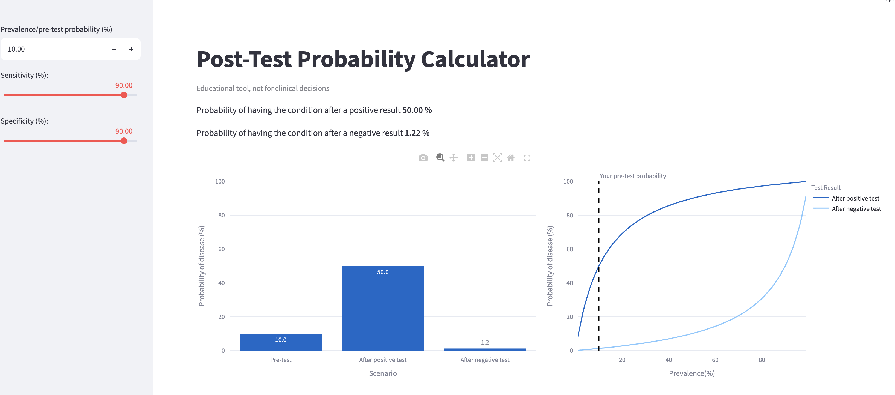
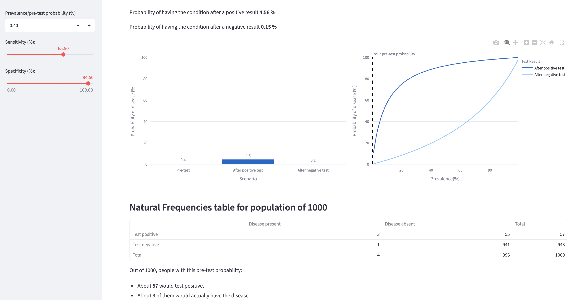

# Post-Test Probability Calculator

Interactive Streamlit app showing how a positive or negative test result
changes the probability of disease, given prevalence, sensitivity and specificity.

## Screenshot 



## Live Demo
**Live demo:** <https://sens-spec-tool-jfm22fg4anlxmby6sn7gqj.streamlit.app/>


## What it does
- Inputs: pre-test probability (prevalence), sensitivity, specificity; all as a percentage 
- Outputs: probability of disease after a positive and a negative result, a natural-frequency sentence ("out of 1,000 people..."), and charts comparing pre- and post-test probability after a positive or negative result 


<!-- Worked example -> to be added 
iFOBT for colorectal neoplasia (sensitivity X%, specificity Y%, source: <citation>).
At 10% prevalence, a positive result gives Z% probability of disease...
-->

## Real Life Example 
There is a wide range of sensitivity and specificity for the FOBT blood test used to screen colon cancer

Using statistics reported by Morikawa et.al 2005

Sensitivity of one day FOBT for invasive cancer: 65.8
Specificity: 94.6

*Note does not include precancerous and is not stratified for proximal and distal colon as in the study

Invasive cancer was 0.4% of cases, adenomas in 16.5% of cases 

Using the tool: 
Probability of having the condition after a postiive result: 4.56% 
Probability of having the condition after a negative results: 0.15%



## How it works
```
PPV = TP / (TP + FP)   
NPV = TN / (TN + FN)
Sens = TP/ (TP+FN)
Spec = TN/ (TN+FP)
```

General layout of a 2 by 2 Contingency Table 

|               | Disease present | Disease absent | Total |
|---------------|----------------:|---------------:|------:|
| Test positive |              TP |             FP |       |
| Test negative |              FN |             TN |       |
| Total         |                 |                |       |

Example: 10% prevalence, 90% sensitivity, 90% specificity

|               |Disease present | Disease absent | Total |
|---------------|----------------:|---------------:|------:|
| Test positive |              90 |             90 |   180 |
| Test negative |              10 |            810 |   820 |
| Total         |             100 |            900 |  1000 |
```
PPV = 90/180 = 50%
NPV = 810/820 = 98.8%
Chances of having the disease after a negative result is (1 - NPV) = 1.2%
```
## Interpretation of Example 
A clinical interpretation of this test is that it is a good test for ruling out a disease if we think the patient has the same likelihood as the general population. However if your pretest probability is high e.g. 90% -> the graph shows that the chance you have the disease after a negative result is still 50% 

## Limitations
- Predictive values depend heavily on prevalence; the same test performs very differently in screening and symptomatic populations.
- Sensitivity and specificity vary with patient mix and disease stage.
- Educational tool, not a replacement for clinical judgement

## Run locally
```bash
pip install -r requirements.txt
streamlit run SS.py
```

## Tests
```bash
pip install -r requirements-dev.txt
pytest test_cm.py
```

## References
Morikawa T, Kato J, Yamaji Y, Wada R, Mitsushima T, Shiratori Y (2005) A comparison of the immunochemical fecal occult blood test and total colonoscopy in the asymptomatic population. Gastroenterology 129: 422–428 
