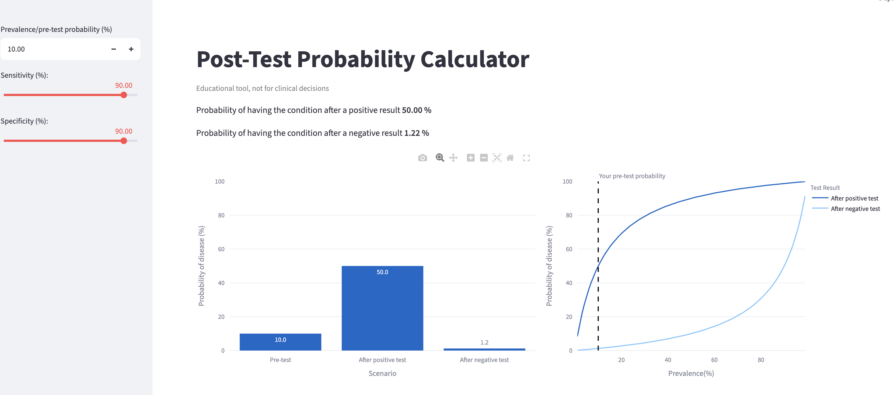

# Post-Test Probability Calculator

Interactive Streamlit app showing how a positive or negative test result
changes the probability of disease, given prevalence, sensitivity and specificity.

## Screenshot 


<!-- Live demo:** //add later? -->


## What it does
- Inputs: pre-test probability (prevalence), sensitivity, specificity; all as a percentage 
- Outputs: probability of disease after a positive and a negative result, a natural-frequency sentence ("out of 1,000 people..."), and charts comparing pre- and post-test probability after a positive or negative result 


<!-- Worked example -> to be added 
iFOBT for colorectal neoplasia (sensitivity X%, specificity Y%, source: <citation>).
At 10% prevalence, a positive result gives Z% probability of disease...
-->

## How it works
```
PPV = TP / (TP + FP)   
NPV = TN / (TN + FN)
Sens = TP/ (TP+FN)
Spec = TN/ (TN+FP)
```

General layout of a 2 by 2 Contingency Table 

|               | Disease present | Disease absent | Total |
|---------------|----------------:|---------------:|------:|
| Test positive |              TP |             FP |       |
| Test negative |              FN |             TN |       |
| Total         |                 |                |       |

Example: 10% prevalence, 90% sensitivity, 90% specificity

|               |Disease present | Disease absent | Total |
|---------------|----------------:|---------------:|------:|
| Test positive |              90 |             90 |   180 |
| Test negative |              10 |            810 |   820 |
| Total         |             100 |            900 |  1000 |
```
PPV = 90/180 = 50%
NPV = 810/820 = 98.8%
Chances of having the disease after a negative result is (1- NPV)/100 = 1.2%
```
## Interpretation of Example 
A clinical interpretation of this test is that it is a good test for ruling out a disease if we think the patient has the same likelihood as the general population. However if your pretest probability is high e.g. 90% -> the graph shows that the chance you have the disease after a negative result is still 50% 

## Limitations
- Predictive values depend heavily on prevalence; the same test performs very differently in screening and symptomatic populations.
- Sensitivity and specificity vary with patient mix and disease stage.
- Educational tool, as a clinical aid but not replacement for clinicans to interpret statistics

## Run locally
```bash
pip install -r requirements.txt
streamlit run SS.py
```

## Tests
```bash
pip install -r requirements-dev.txt
pytest test_cm.py
```